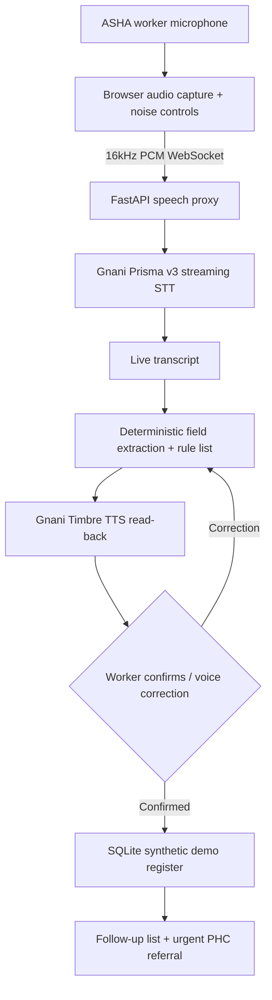

# ASHA VoiceCare — Gnani Voice Hackathon PS1

**Track:** PS1 Healthcare — Voice field register for ASHA workers.

This runnable prototype keeps the existing ASHA VoiceCare REST API endpoints and adds a Gnani streaming speech path. The browser captures mono audio, requests echo cancellation/noise suppression/automatic gain control, downsamples to 16 kHz PCM16, and sends raw audio frames through a FastAPI WebSocket proxy to **Gnani Prisma v3.0**. Transcription events update the live transcript. Structured extraction remains deterministic and the worker confirms read-back before a record is saved. Danger-sign escalation is phrase-list based and does not diagnose or suggest treatment.

## Gnani platform setup

1. Get a Gnani API Platform key for your team.
2. Copy `.env.example` to `.env` in this project folder.
3. Set `GNANI_API_KEY` privately. Never paste it into chat, frontend code, or GitHub.
4. Keep `GNANI_STT_MODEL=prisma-v3.0`.
5. This hackathon brief names **Timbre v3.0**. The code first requests `GNANI_TTS_MODEL=timbre-v3.0`; the currently published `gnani-vachana` SDK docs list Timbre v2.0 and v2.5. If your team account/SDK does not accept v3.0, change this environment setting to `timbre-v2.5` (supported by the published SDK) and verify the exact model available in your Gnani console. TTS failure uses browser speech as a demo fallback; this fallback is not the required Gnani speech service.

## Windows setup (PowerShell)

Open this folder in VS Code. In Terminal:

```powershell
py -3.11 -m venv .venv
.\.venv\Scripts\Activate.ps1
python -m pip install --upgrade pip
pip install -r requirements.txt
Copy-Item .env.example .env
```

Edit `.env` to add your Gnani API key. Start:

```powershell
uvicorn backend.main:app --reload
```

Open **http://127.0.0.1:8000/**. Grant microphone permission. A browser on localhost is required for microphone access. Do not deploy this demo with real patient data.

## Flow

1. Tap **Start live stream**. The app discloses it is an AI voice assistant.
2. Browser sends 16 kHz signed PCM16, mono frames (512 samples / 1024 bytes each) to `/ws/gnani-stt`.
3. FastAPI passes the audio frames to Gnani Prisma streaming. Transcript segments appear live.
4. Stop; extraction identifies beneficiary ID, visit type, weight, vaccination status/items and numeric next-visit date.
5. Agent reads the fields aloud using Gnani Timbre (realtime synthesis); browser speech is a fallback if Gnani TTS is unavailable.
6. **Correct by voice**: speak a correction. Current voice parser supports beneficiary ID, weight, visit type, TT/IFA/vaccine mention, date in numeric day/month/year format and “yes/save”. Re-check the form after correction.
7. Worker confirms read-back. API saves the record and generates follow-ups.
8. Danger phrase matches trigger a red warning and spoken PHC referral immediately when a transcript segment contains the phrase; save also sets `danger_flag` and creates an urgent follow-up.

## Existing API routes preserved

- `GET /api/health`
- `POST /api/transcribe` (Gnani file STT endpoint, compatibility)
- `POST /api/extract`
- `POST /api/validate`
- `POST /api/visits`
- `GET /api/visits`
- `GET /api/followups`

New speech endpoints:
- `WS /ws/gnani-stt?language=indic-auto` — live audio stream. Use a supported locale such as `kn-IN` or auto-detect `indic-auto`.
- `POST /api/tts` — Gnani realtime TTS synthesis used for spoken read-back/referral.

## Architecture



## Test/demo phrases (synthetic)

- `Beneficiary ID SYN-1001, ANC checkup, weight 58 kilo, IFA goli given, TT injection pending, next visit 05/12/2026.`
- Correction: `No, weight 2.8 kilo.`
- Danger: `Beneficiary SYN-1002 newborn has high fever.`
- Danger: `Beneficiary SYN-1001 bleeding during pregnancy.`

Expected: all captured fields are read back; correction updates weight; danger phrase triggers referral warning; save is blocked until beneficiary ID and confirmation are supplied.

## Danger-sign list and source citations

The phrase rules include the PS1 examples (bleeding in pregnancy and newborn fever) and a selected subset of maternal signs from the India MCP Card (excess bleeding, high fever, headache/visual symptoms/fits/swelling, prolonged labour, and water-bag rupture) plus selected newborn signs from NHM newborn guidance (poor feeding, convulsions, breathing difficulty, feeling cold, yellow palms/soles, and blood in stool). Phrase matching is literal substring matching: variants not listed may be missed. This is a **demo subset**, not a complete clinical guideline or validated danger-sign classifier. Have a clinical/public-health mentor validate local translations, thresholds, age definitions, and referral pathways before submission or any field use.

References to review and cite in the final README with exact page/section numbers after validation:

- Government of India, MoHFW, **Revised India MCP Card (2018)**, page 6, “Danger Signs During Pregnancy and Delivery” (bleeding, excessive bleeding, severe anaemia, fever, headache/visual changes/fits/swelling, prolonged labour, rupture of water bag): https://nhm.gov.in/New-Update-2022-24/CH-Programmes/HBNC-%26-HBYC-Resource-%20Material/Revised-India-MCP-Card-English-%2828-05-2018%29.pdf
- Government of India, NHM, **Samagra Shishu Bal Swasthya Karyakram (SSBSK) Operational Guideline 2026**, page 22, Table 3.3 “Criteria for Danger Signs in newborn” (not feeding, convulsion, breathing difficulty, temperature 37.5°C or above, low temperature, jaundice, blood in stool, etc.): https://www.nhm.gov.in/New-Update-2025-26/Guidelines/SSBSK/SSBSK_Operational%20Guidline_Final_06-08-2026.pdf
- Government of India, NHM, **Revised HBNC Operational Guidelines (2014)**, page 22, newborn signs table: https://nhm.gov.in/New-Update-2022-24/CH-Programmes/HBNC-%26-HBYC-Resource-%20Material/Revised_HBNC-OG-2014-English.pdf
- Government of India, MoHFW, **Comprehensive Emergency Obstetric and Newborn Care (CEmONC) curriculum, Part 2**, page 70, “When to seek care for Neonate”: https://nhm.gov.in/images/pdf/programmes/maternal-health/guidelines/Revised_CEmONC_curriculum_2024-Part_2.pdf

Danger-sign alerts follow the configured list only and provide referral messaging only; no diagnosis, medicine, or treatment advice is produced. PS1 requires a guideline-sourced list. These source documents must be checked by the team; the present two-rule demo subset is not represented as a complete guideline implementation.

## Responsible AI / privacy

- Synthetic beneficiary IDs only. No real patient names, phone numbers, addresses, Aadhaar, medical records, or patient audio.
- Audio is streamed to Gnani for transcription; understand provider data handling and hackathon terms before using any non-synthetic data.
- Local SQLite demo database and transcript are not encrypted. This prototype is for hackathon demonstration only; do not use real health data.
- No voice cloning. First-turn AI disclosure is included.
- No diagnosis, treatment or dosage advice. Referral only from the approved phrase list.
- API key is in `.env` and `.gitignore`, never frontend or committed repository.

## Known limitations (disclose in demo)

- Browser audio resampling is a basic averaging downsampler, not a dedicated noise-reduction DSP; device noise controls are browser/hardware dependent.
- Gnani stream events are segment/final style as provided by the service; a word-by-word interim transcript is not guaranteed by every API response.
- Voice correction parser is intentionally narrow and should be expanded/tested across supported languages; corrections can also be reviewed in the form.
- Numeric dates only; relative dates such as “next week” are not inferred.
- The Timbre v3.0 model name is set as requested by the challenge brief; verify model availability with your platform account. SDK docs currently list v2.0/v2.5, so use v2.5 if v3 is not enabled.
- Danger detection recall is not clinically validated; use explicit test utterances and report recall and false-alert counts.

## Deliverables checklist

- [ ] Gnani key configured privately
- [ ] Live judge demo with Kannada/code-mix and household/street background noise
- [ ] Measure field-level accuracy (ID, visit type, weight, vaccination, date)
- [ ] Measure danger-sign recall; missed signs carry double penalty in PS1
- [ ] Demo recording 2–3 minutes
- [ ] Pitch deck up to six slides
- [ ] Public repository README and architecture

## Run tests

```powershell
pytest -q
```
